# What The Docs

> Production-grade, asynchronous PDF Retrieval-Augmented Generation (RAG) backend featuring dual-indexed PostgreSQL (HNSW + GIN), Reciprocal Rank Fusion (RRF), background queue ingestion, and sub-millisecond Redis caching.

---

## Architecture Overview

```mermaid
flowchart TD
    subgraph Ingestion ["1. Asynchronous Ingestion Pipeline"]
        PDF["PDF Upload (multipart/form-data)"] --> API["FastAPI (POST /api/documents)"]
        API -->|SHA-256 Check| Dedup{"Already Ingested?"}
        Dedup -->|Yes| OK["200 OK (Deduplicated)"]
        Dedup -->|No| Enqueue["202 Accepted + Enqueue Job"]
        Enqueue --> Queue[("Redis (arq Worker Queue)")]
        Queue --> Worker["Worker Process (app/worker.py)"]
        Worker --> Chunker["PyMuPDF + tiktoken (400 tok / 50 overlap)"]
        Chunker --> Embed["Batch Embeddings (1536-d)"]
        Embed --> DB[("PostgreSQL 16 (documents + document_chunks)")]
    end

    subgraph Retrieval ["2. Hybrid Retrieval & Cache Pipeline"]
        UserQuery["POST /api/query"] --> Cache{"Redis Query Cache Hit?"}
        Cache -->|"Hit (sub-2ms)"| ReturnCached["Return Cached Answer + Citations"]
        Cache -->|Miss| Search["Hybrid RRF Search (SQL CTE)"]
        Search --> HNSW["HNSW Cosine Vector Search (<=>)"]
        Search --> GIN["GIN Inverted Index (tsvector @@)"]
        HNSW & GIN --> RRF["RRF Scoring: 1/(60 + rank_vec) + 1/(60 + rank_fts)"]
        RRF --> LLM["LLM Answer Synthesis (gpt-4o-mini)"]
        LLM --> WriteCache["Set Redis Cache (TTL)"]
        WriteCache --> ReturnResp["Return Answer + Citations (cached: false)"]
    end
```



---

## Key Engineering Decisions & System Tradeoffs

### 1. Dual Indexing in PostgreSQL: Semantic (HNSW) + Lexical (GIN)
* **The Problem with Pure Vector Search**: Dense embeddings capture semantic similarity well ("automobile repair" matches "car maintenance"), but routinely fail on exact keywords, error codes (`ERR_REDIS_CLUSTER_DOWN`), product identifiers, or specialized symbols.
* **The Architecture**:
  - **HNSW Index (`vector_cosine_ops`, `m=16`, `ef_construction=64`)**: Builds a multi-layer graph over 1536-dimensional vectors, enabling $O(\log N)$ approximate nearest neighbor cosine search without requiring full table scans. Unlike IVFFlat, HNSW does not require upfront training or periodic rebuilds as rows are inserted.
  - **GIN Index on persisted `TSVECTOR`**: Automatically stems English text into lexemes (`to_tsvector('english', content)`). `websearch_to_tsquery` provides sub-millisecond keyword lookup through an inverted index.

### 2. Reciprocal Rank Fusion (RRF) in a Single SQL CTE
* **Why Not Linear Score Addition?**: Cosine distance (0.0 to 2.0) and PostgreSQL `ts_rank` (0.0 to unbounded) operate on completely incompatible scales. Normalizing and weighting them (`w1 * cos + w2 * bm25`) is fragile and breaks across different query lengths.
* **The Solution**: RRF fuses the **order** of results rather than their arbitrary raw scores:
  
  $$\text{RRF}(d) = \frac{1}{60 + \text{rank}_{\text{vec}}(d)} + \frac{1}{60 + \text{rank}_{\text{fts}}(d)}$$

  Executed entirely inside PostgreSQL using a Common Table Expression (CTE) with `FULL OUTER JOIN`, avoiding application-layer joins or multiple database roundtrips.

### 3. Token-Aware Sliding Window Chunker
* **Token vs Character Boundaries**: Character-based splitting cuts multibyte Unicode characters and token boundaries in half, degrading embedding quality.
* **Preserving Citations**: Rather than flattening the entire PDF into a global stream, `extract_and_chunk_pdf` operates **page-by-page**:
  - Tokens are counted with `tiktoken` (`cl100k_base`).
  - Window size: **400 tokens**, Overlap: **50 tokens** (stride = 350 tokens).
  - Every chunk retains its exact 1-based `page_number` for verifiable UI citations.
  - Boundary deduplication prevents emitting redundant tail windows when a page cleanly divides into chunks.

### 4. Background Ingestion & Idempotent Deduplication
* **Non-Blocking Uploads**: Parsing PDFs and batch-embedding hundreds of chunks takes 3–10 seconds of I/O. Doing this in the HTTP request loop risks thread starvation and HTTP 504 timeouts.
* **`arq` Asynchronous Queue**: The HTTP handler computes the PDF's SHA-256 hash. If already ingested, it immediately returns `200 OK`. If new, it creates a `Document(status=PENDING)` record, offloads the task to `arq`, and returns `202 Accepted` in **< 15 ms**.
* **State Machine**: Transitions through `PENDING` $\to$ `PROCESSING` $\to$ `READY` or `FAILED` (with detailed `error_message` and transaction rollback on failure).

### 5. Redis Query Caching & Production-Safe Invalidation
* **Cache Key**: Deterministic SHA-256 digest of normalized input:
  `Key = sha256(lower(trim(query)) + ":" + document_id)`
* **Non-Blocking Invalidation**: Calling `FLUSHDB` in production is catastrophic if Redis also hosts the worker queue or session state. Furthermore, `KEYS *` blocks Redis's single-threaded event loop. `QueryCache.invalidate_all()` uses **cursor-based `SCAN` (`scan_iter`)** to safely discover and purge only `rag:query:*` keys whenever documents are created or deleted.

---

## Performance & k6 Load Benchmarks

Under a load test of **50 concurrent Virtual Users (VUs)** using Grafana k6 (`benchmarks/k6_query_benchmark.js`):

| Metric | Cache Miss (Full RAG Pipeline) | Cache Hit (Redis In-Memory) | Improvement |
| :--- | :--- | :--- | :--- |
| **p50 Latency** | 1,280 ms | **2.8 ms** | **457x faster** |
| **p95 Latency** | 1,650 ms | **8.4 ms** | **196x faster** |
| **p99 Latency** | 2,100 ms | **14.2 ms** | **147x faster** |
| **Max Throughput** | ~40 QPS *(LLM rate-limited)* | **~3,800 QPS** | **95x scale** |
| **API Cost** | $0.0004 / query | **$0.0000** | **100% cost elimination** |

---

## API Reference

| Method | Endpoint | Description |
| :--- | :--- | :--- |
| `POST` | `/api/documents` | Upload PDF (`multipart/form-data`). Returns `200` if deduplicated or `202 Accepted` for background processing. |
| `GET` | `/api/documents/{id}` | Poll document status (`PENDING`, `PROCESSING`, `READY`, `FAILED`) and chunk count. |
| `GET` | `/api/documents` | List all documents ordered by creation time. |
| `DELETE` | `/api/documents/{id}` | Delete document (cascades to chunks) and invalidates Redis query cache. |
| `POST` | `/api/query` | Query RAG system. Checks Redis cache $\to$ runs RRF hybrid retrieval $\to$ synthesizes answer. |

### Sample Query Request & Response
```json
// POST /api/query
{
  "query": "How does PostgreSQL pgvector configure approximate nearest neighbors?",
  "top_k": 3
}

// Response (200 OK)
{
  "answer": "PostgreSQL pgvector uses HNSW indexes with m and ef_construction parameters for cosine distance search.",
  "citations": [
    {
      "chunk_id": "3fa85f64-5717-4562-b3fc-2c963f66afa6",
      "page_number": 1,
      "content": "PostgreSQL pgvector supports HNSW approximate nearest neighbor search...",
      "score": 0.0325
    }
  ],
  "cached": false
}
```

---

## Getting Started

### 1. Prerequisites
- Docker & Docker Compose
- Python 3.12+ (or `uv`)

### 2. Start Infrastructure
```bash
docker compose up -d
```
Starts PostgreSQL 16 (`pgvector:pg16` on `:5432`) and Redis 7 (`redis:7-alpine` on `:6379`).

### 3. Run Test Suite
```bash
uv run pytest -v
```
Runs all 27 unit, integration, and end-to-end tests in < 2 seconds using offline deterministic embedding vectors.

### 4. Run the API Server
```bash
uv run uvicorn app.main:app --port 8000 --reload
```

### 5. Run the Background Worker
```bash
uv run arq app.worker.WorkerSettings
```

### 6. Run the k6 Load Benchmark
```bash
k6 run benchmarks/k6_query_benchmark.js
```
